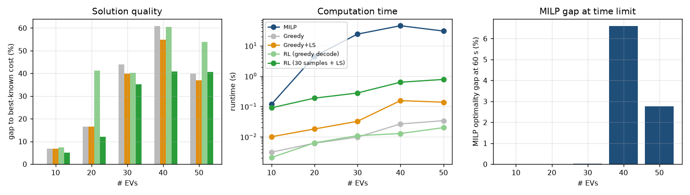
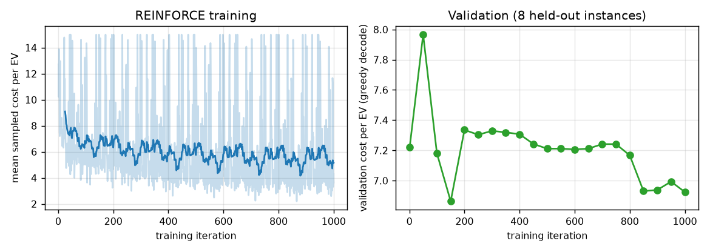
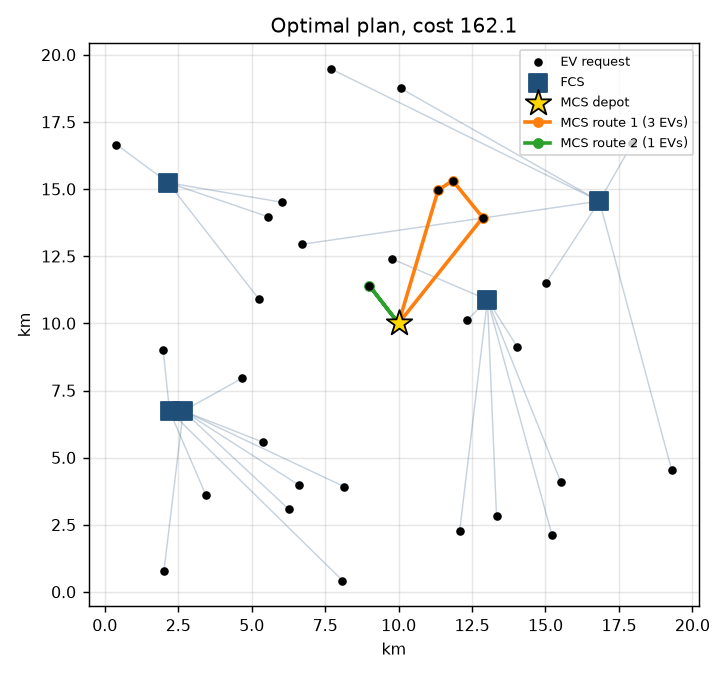
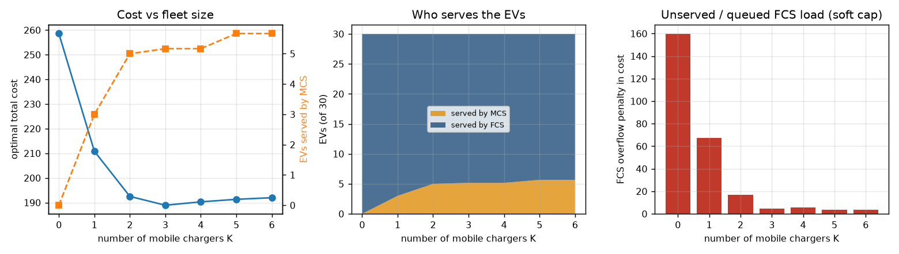
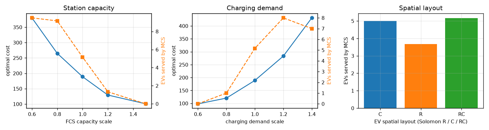
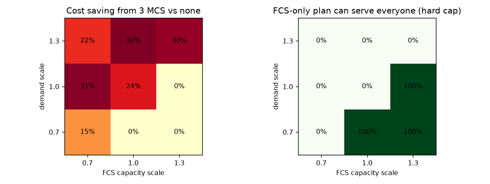

# EV Charging Network Optimization — FCS/MCS assignment + mobile-charger routing

Course project (CP320 – OR4Mobility). A Charging Network Operator must decide, for every EV charging request in an
evening-peak horizon, whether it is served by a **fixed charging station (FCS)** or a **mobile charging van (MCS)**,
and in which order each van visits its EVs, at minimum total cost.

Everything here is reproducible from this folder (Python 3.13, `numpy pandas matplotlib highspy tabulate`; the MILP is
solved with **HiGHS**; the learning method is a numpy REINFORCE agent, because no deep-learning framework or
Gurobi/CPLEX/OR-Tools was available on the machine).

```
evcharge/instance.py    instance data class + Solomon-style generator (R / C / RC layouts)
evcharge/milp.py        the MILP (highspy)
evcharge/solution.py    independent feasibility checker + exact cost evaluator
evcharge/heuristics.py  greedy baseline, constructive builder, local search
evcharge/rl.py          learning-to-optimize (REINFORCE policy)
evcharge/generate.py    feasible-instance generator
train_rl.py             trains the policy  -> results/rl_policy.json
run_experiments.py      quality/speed experiment + sensitivity analysis -> results/*.csv
make_report.py          figures + tables
```
Run: `python train_rl.py 1000 && python run_experiments.py all && python make_report.py`

---

## 1. Problem formulation (MILP)

**Sets.** EVs `i ∈ N = {1..n}`, depot `0`, FCS `j ∈ J = {1..m}`, `K` identical vans.

**Data.** `q_i` demand (kWh); `[e_i, l_i]` time window in which a van must *start* charging EV `i` (request release / patience);
`d_ij` EV→FCS distance, `d_ab` van distance, `τ_ab = d_ab / v`; FCS power 22 kW, so `δ_i = q_i / 22` gun-hours at an FCS;
van power 22 kW → service time `s_i = q_i / 22`; `C_j = 2 guns × T × (free fraction)` available gun-hours of FCS `j`;
van battery `Q`, horizon `T = 4 h`.

**Decision variables.**
`z_ij ∈ {0,1}` EV `i` charges at FCS `j` · `x_ab ∈ {0,1}` a van drives `a→b` (`a,b ∈ {0}∪N`) ·
`t_i` service start time of EV `i` at a van · `u_i` cumulative energy delivered on the route up to `i` ·
`o_j ≥ 0` overflow gun-hours (only in the soft-capacity variant used for analysis).

**Objective** (total operating cost)

```
min  Σ_ij (c_ev + λ_ev/v)·d_ij·z_ij          EV driving cost + detour-inconvenience penalty
   + Σ_ab c_mcs·d_ab·x_ab                      van travel cost
   + Σ_j f_mcs·x_0j                            van dispatch (operating) cost
   + Σ_ab c_batt·q_b·x_ab                      van energy / battery-wear cost
   + Σ_i λ_wait·(t_i − e_i)                    waiting-time inconvenience penalty
   [+ Σ_j π·o_j]                               overflow penalty (soft variant only)
```

**Constraints**

| | |
|---|---|
| (1) each EV exactly one resource | `Σ_j z_ij + Σ_{a≠i} x_ai = 1`  ∀i |
| (2) flow conservation | `Σ_a x_ai = Σ_b x_ib`  ∀i |
| (3) fleet size, vans start & end at depot | `Σ_j x_0j ≤ K`,  `Σ_j x_0j = Σ_j x_j0` |
| (4) van battery + subtour elimination | `q_i ≤ u_i ≤ Q`,  `u_b ≥ u_a + q_b − Q(1−x_ab)` |
| (5) time windows / route duration | `e_i ≤ t_i ≤ l_i`, `t_b ≥ t_a + s_a + τ_ab − M_ab(1−x_ab)`, `t_i ≥ τ_0i·x_0i`, `t_i + s_i + τ_i0 ≤ T` if `x_i0 = 1` |
| (6) FCS capacity (2 guns × 22 kW) | `Σ_i δ_i z_ij ≤ C_j (+ o_j)` ∀j |
| domain | binaries / non-negatives |

A van serves one EV at a time (single path), so the model is a VRP with time windows and a battery capacity, coupled
with a generalised-assignment problem for the stations. Pre-processing removes arcs that can never be used
(time-window or battery infeasible).

*Modelling notes / simplifications.* FCS capacity is aggregated into gun-hours (2 guns × available time), i.e. we do not
schedule individual EVs on individual guns inside an FCS; EV and van speed are equal (30 km/h); distances are Euclidean.
`evcharge/solution.py` re-computes cost and re-checks every constraint independently of the MILP; the MILP objective and the
recomputed cost agreed on all 24 instances spot-checked (hard and soft capacity).

## 2. Solution methods

1. **Mathematical programming** – the MILP above with HiGHS (`mip_rel_gap = 1e-4`, 60 s limit).
2. **Learning to optimize (RL)** – a constructive policy builds a plan EV by EV (largest demand first). For each EV the action set is
   *{charge at FCS j} ∪ {insert into van k at its cheapest feasible position}* (feasible w.r.t. station capacity, battery,
   time windows, horizon). The policy is `π(a|s) = softmax(w·φ(s,a))` with 10 size-independent features (normalized marginal
   cost, remaining/used station capacity, van-empty flag, battery slack, time slack, and a global "capacity pressure"
   = unassigned demand / free station capacity, interacting with FCS vs MCS). It is trained with **REINFORCE** (batch of 16 rollouts,
   mean baseline, standardized advantages, Adam) on 150 random feasible instances (12–40 EVs, 1–4 vans, R/C/RC layouts,
   random demand/capacity) with seeds disjoint from the test set. Dead ends (needing an over-full station) get a capped
   failure penalty. At inference: greedy decoding, or best of 30 sampled rollouts followed by local search (relocate + 2-opt).
   One trained policy transfers to every instance size. Training takes ≈ 2 minutes.
3. **Baselines** – cheapest-insertion greedy (two EV orderings), and greedy + local search.

## 3. Experimental evaluation

**Data.** Solomon-style synthetic instances (R random / C clustered / RC mixed customers in a 20×20 km city, depot in the centre,
time windows of 0.75–1.5 h, demand ~ N(20, 7²) kWh clipped to [8, 40], stations with heterogeneous free capacity so that some are congested).
Only instances for which a feasible plan exists are used. Sizes (EVs/FCS/MCS): 10/3/1, 20/4/2, 30/6/3, 40/8/4, 50/10/4; 5 instances each
(25 total, layouts cycling R, C, RC).

**Solution quality and speed** (`results/table_quality.csv`, `fig_quality.png`). `gap` = mean over instances where the method returned a feasible
plan of `(cost − best known)/best known`; `feas` = fraction of instances where the method found a feasible plan at all.

| #EVs | MILP time (s) | MILP proven optimal | MILP gap at limit | Greedy gap / feas | Greedy+LS gap / feas | RL greedy-decode gap / feas | RL 30 samples+LS gap / feas | RL+LS time (s) |
|---|---|---|---|---|---|---|---|---|
| 10 | 0.12 | 100% | 0 | 6.9% / 1.0 | 6.9% / 1.0 | 7.3% / 1.0 | **5.1%** / 1.0 | 0.09 |
| 20 | 4.5 | 100% | 0 | 16.5% / 0.6 | 16.5% / 0.6 | 41.3% / 0.6 | **12.1%** / 0.6 | 0.19 |
| 30 | 24.2 | 100% | 0 | 43.9% / 0.6 | 40.0% / 0.6 | 40.3% / 0.6 | **35.2%** / 1.0 | 0.28 |
| 40 | 45.7 | 40% | 6.6% | 60.9% / 1.0 | 54.9% / 1.0 | 60.5% / 1.0 | **40.9%** / 1.0 | 0.63 |
| 50 | 30.5 | 80% | 2.8% | 39.9% / 1.0 | 36.9% / 1.0 | 53.9% / 1.0 | **40.7%** / 1.0 | 0.78 |

Honest reading of these results:
* The exact MILP is far better than every heuristic in cost (the heuristics are 5–60 % above it) but its run time grows from 0.1 s to tens of seconds,
  and at 40–50 EVs it often cannot prove optimality within 60 s (remaining gap ≈ 3–7 %). The heuristics need 0.01–0.8 s, i.e. 40–100× faster.
* Within the fast methods, the RL policy with sampling + local search is the best on average (it lowers the cost versus greedy+LS in 4 of 5 sizes and finds feasible
  plans where plain greedy fails), but **greedy decoding of the learned policy alone is only on par with the greedy baseline** (the
  validation cost per EV improved from ≈ 8.0 to ≈ 6.9 during training, vs 7.0 for greedy). With a linear policy over hand-made features the learned
  component is modest; most of the benefit comes from combining it with sampling and local search.
* Hard station capacity is a tight bin-packing-like constraint: myopic constructive methods hit dead ends (feasibility 0.6 for greedy at n = 20, 30).
  Gaps are measured on the instances each method solved, so rows with `feas < 1` are not directly comparable.
* Possible improvements not done here: a neural (attention) policy, beam search, or using the learned policy to warm-start the MILP.

  

## 4. Analysis: mobile chargers, station capacity and demand

Base case: 30 EVs, 5 FCS, RC layout, 6 random instances per setting. To keep the model feasible when there are too few resources, the sweeps
use the **soft-capacity variant** (overflow at a station costs 30 per gun-hour, representing queueing/abandonment); the column *hard-feasible* reports how often
the original "serve everyone" model is feasible. (Each point is a 30 s MILP; for K > 3 the small cost increase is solver noise from the time limit, not a real effect.)

**Number of mobile chargers K** (`fig_fleet_size.png`)

| K | 0 | 1 | 2 | 3 | 4 | 5 | 6 |
|---|---|---|---|---|---|---|---|
| total cost | 258.6 | 210.9 | 192.5 | **188.9** | 190.3 | 191.3 | 192.0 |
| EVs served by MCS | 0 | 3.0 | 5.0 | 5.2 | 5.2 | 5.7 | 5.7 |
| overflow penalty in cost | 159.7 | 67.3 | 16.9 | 4.7 | 5.7 | 3.5 | 3.5 |
| "serve everyone" feasible | 0% | 17% | 67% | 100% | 100% | 100% | 100% |

The first one to three vans give large savings (−27 % cost with 3 vans) and turn an infeasible problem into a feasible one; after K ≈ 3 returns vanish – vans only
serve ≈ 5–6 EVs in total because every van is limited by the 4-hour horizon, its time windows and its fixed dispatch cost, and the remaining congestion is
cheap to handle at the stations. Vans are used for the EVs that would otherwise overload the busiest stations and for EVs close to the depot (see the example plan).

**Station capacity** – cost falls steeply as stations get bigger (scale 0.6 → 1.5: 380 → 101) and the number of EVs served by vans falls from 9.5 to 0:
mobile chargers are a substitute for station capacity. With scarce capacity (≤ 0.8×) the FCS-only plan is infeasible in 67–100 % of the cases.

**Charging demand** – cost grows super-linearly with demand (0.6× → 1.4×: 98 → 431). At low demand (≤ 0.6×) no van is needed; as demand exceeds station capacity
the optimum dispatches more vans (0 → 3) until the fleet itself saturates (1.4×: 7 EVs by vans, overflow 210) – the fleet cannot absorb a demand surge by itself.

**Spatial layout** – clustered/mixed demand (C, RC) uses more mobile service (5.0–5.2 EVs) than uniformly scattered demand (R, 3.7): clusters far from stations make a
single van trip serve several EVs, which is where routing pays off.

**Where do mobile chargers help most?** (`fig_scenarios.png`, 3 vans vs none, demand × station-capacity grid, soft model)

| demand \ station capacity | 0.7× | 1.0× | 1.3× |
|---|---|---|---|
| 0.7× | 15 % | 0 % | 0 % |
| 1.0× | 31 % | 24 % | 0 % |
| 1.3× | 22 % | 32 % | 30 % |

Mobile chargers give 15–32 % cost savings whenever demand is high relative to station capacity (peak demand, congested stations, small or partly booked stations), and
no benefit when stations have slack (low demand or large stations). Because the vans supplement rather than replace the stations, the savings are largest at the
"congested but not hopeless" point (demand 1.0–1.3× with capacity 0.7–1.0×).

  

## 5. Limitations
* FCS capacity is aggregated gun-hours (no per-gun schedule); the stations' pre-existing booking is a fixed fraction of time.
* Single depot, homogeneous fleet, Euclidean distances, static requests (the optional dynamic / time-varying-price / congestion extensions were not implemented).
* The RL policy is a linear softmax policy trained with numpy REINFORCE; it is much weaker than the MILP in cost on the tested sizes, and its edge over greedy is
  mainly obtained with sampling + local search.
* Sensitivity analysis uses 6 random instances per setting and a 30 s MILP limit, so small differences (≈ 1–2 %) are within noise.
